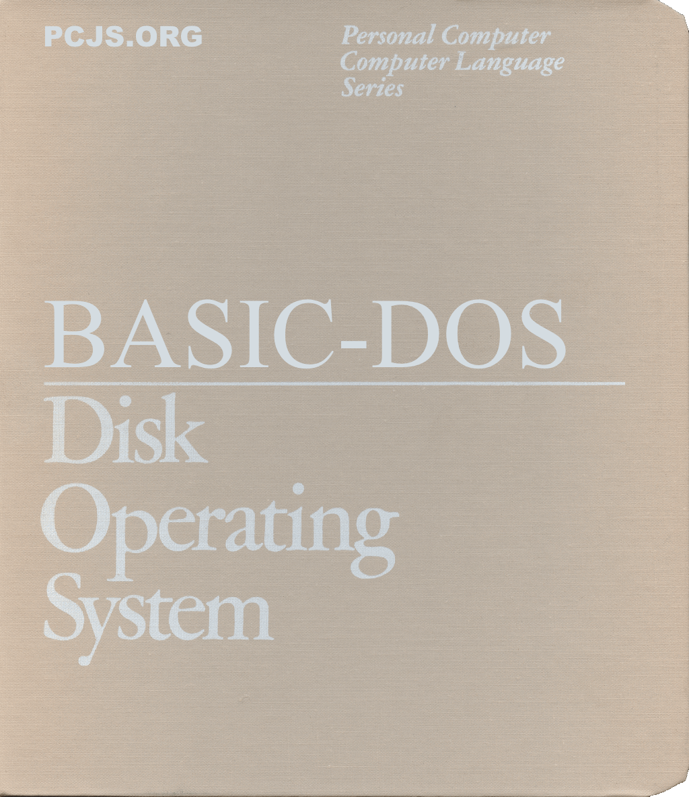

In 2020, I started work on [BASIC-DOS](https://basicdos.com), aka "PC DOS Reimagined", an operating system that *could* have shipped with the IBM PC in 1981.  My original goal was to have a working prototype in time for the IBM PC's 40th anniversary (August 2021).  And in early 2021, I unveiled a "Preview", which you can still see [here](https://basicdos.com/blog/2026/11/07/).

That preview was a technology demo with lots of limitations: a read-only file system, no utilities, and very limited BASIC functionality -- "basically", just enough BASIC language support to run a `PRIMES.BAS` prime number demo.

However, in a few ways, BASIC-DOS did surpass PC DOS: it supported 32-bit integers (Microsoft BASIC integers were limited to 16-bit precision), and it was much faster, because it actually compiled BASIC statements into native 8086 instructions rather than interpreting them.

And BASIC-DOS multitasked: you could create multiple sessions, either on a split-screen or across multiple screens, and they ran *simultaneously* on the original IBM PC.  In retrospect, PC DOS was a poor demonstration of that hardware's potential.

Regrettably, that was as far as I got with the BASIC-DOS project.  I ran out of steam, the 40th anniversary of the IBM PC came and went, and life progressed.

Until 2026....

[](https://basicdos.com/)

## Reimagining the Reimagining in 2026

Fast-forward five years, and with AI agents like Claude Code, I discovered that one person with a virtual sidekick could actually finish a project like the one I had started.  The architecture I created and described in BASIC-DOS blog posts "[Inspiration](https://basicdos.com/blog/2020/05/17/)" and "[Perspiration](https://basicdos.com/blog/2020/12/12/)" hasn't changed much, and neither have the constraints: BASIC-DOS is still built with MASM 4.0, it can still run on a 4.77Mhz 8088, and it can still boot in as little as 64K.

Now all the gaping holes in my "Preview" have been filled.  So to my set of original features, which included:

  - Read-only diskette-based file system
  - Session-based multitasking
  - Piped I/O (not faked with temporary files)

BASIC-DOS 2.10 has added support for:

  - Hard disks
  - Subdirectories
  - FAT12 and FAT16 volumes
  - Read-write file system
  - Installable device drivers
  - Fully integrated BASIC language

### Floating-Point

I've now moved far beyond my original vision.  One of my first "new" ideas was a built-in floating-point driver named `FPU$` that contains two completely independent pieces of code: a "thin" set of FPU interfaces used only when a coprocessor is present, and a "thick" set of identical interfaces when no coprocessor is present.  So that checked off two more important features:

  - Floating-point emulation support
  - Floating-point coprocessor support

And BASIC-DOS uses the new FPU interface, so it automatically takes advantage of a coprocessor, which none of the PC DOS or MS-DOS BASIC interpreters could do; they were forced to emulate, due to inherent differences between the [Microsoft Binary Format](https://en.wikipedia.org/wiki/Microsoft_Binary_Format) and the [IEEE 754 Standard](https://en.wikipedia.org/wiki/IEEE_754).

Remember the difficult choices people had to make years ago, deciding whether to build multiple versions of their floating-point apps (ie, with and without emulation)?  If an FPU driver had been standard, most vendors likely would have used it; only those who needed maximum speed would still have opted for inline FPU instructions.

### Protected Mode

Next, I considered the idea of a `CPU$` driver that could help smooth over the differences between 8088 and 80286 processors, making it easier to boot BASIC-DOS in protected mode instead of real mode, and offering the user not only more protection but also access to nearly 16Mb of memory instead of 640K.

As a result, BASIC-DOS didn't just break the 640K barrier; it broke it without requiring a completely different operating system (eg, `OS/2`), and in a way that BASIC apps could immediately take advantage of.  PC DOS and MS-DOS BASIC interpreters were always limited by their 64K memory model; they couldn't even take advantage of 640K, let alone 16Mb.  BASIC-DOS programs, on the other hand, have no such limitation: a BASIC program can grow to fill and use all available system memory.

### Virtual 8086 Mode

Emboldened by my success with 80286 support, I decided to take one more CPU leap and add 80386 support to the new `CPU$` driver, including support for "Virtual 8086 Mode" sessions.  That support, along with the addition of a new `START` command, means that users can start new sessions on the fly, including `V86` sessions.

### New Filters

And I didn't stop there.  BASIC-DOS needed a suite of utilities, including a set of common "filters", so I added:

  - FIND
  - MORE
  - SED
  - SORT
  - TEE
  - TR
  - UNIQ
  - WC

### New Utilities

Next, I decided that a product with BASIC in its name should fully embrace the language, so I "wrote" (by which I mean Claude wrote) a set of traditional DOS utilities *entirely* in BASIC; they include:

  - ATTRIB
  - CHKDSK
  - COMP
  - DISKCOPY
  - FORMAT
  - HEXDUMP
  - LABEL
  - LS
  - MODE
  - SYS
  - TREE
  - VOL

Granted, `HEXDUMP` and `LS` are not "traditional" DOS utilities; I just decided they would be nice to have.

So how do you write a utility like `CHKDSK` or `FORMAT` or `SYS` in BASIC?  All it takes is the ability to issue system calls (see `DOS` and `IOCTL`) and to open volumes (eg, `A:` or `C:`) for sector-level access.

### Editing

BASIC programs can not only be `LOAD`'ed and `LIST`'ed from the command prompt but also `EDIT`'ed: just type `EDIT` followed by a line number to edit an individual line, using any of the editing features described by `HELP KEYS`.  However, if you need to edit more than a single line (or the line you need to edit isn't numbered, because that's *optional* in BASIC-DOS), you can use the bundled version of `VI` (also "written" by Claude) to edit the BAS file.

### Batch Files

In BASIC-DOS, there isn't much difference between BAT and BAS files, because I didn't want `COMMAND.COM` to need a separate "language".  Simple operations like looping a certain number of times, which could be surprisingly difficult in a DOS batch file, are now easy using BASIC-DOS variables:

```
FOR LOOP = 1 TO 10 : DIR : NEXT
```

There is no need for "environment variables"; BASIC-DOS does support environment blocks internally, but only to provide backward-compatibility with old DOS programs.

Instead of PATH and PROMPT environment variables, there are simply `PATH$` and `PROMPT$` string variables.  Instead of `ECHO`ing them, you `PRINT` them, and instead of using `SET` to set them, you use an explicit (or implicit) `LET` to assign new values.

Run the `HELP PROMPT` command and you'll see that the BASIC-DOS `PROMPT$` string is a much more flexible version of the DOS `PROMPT` environment variable, because it leverages BASIC-DOS' built-in *sprintf* functionality.  Ditto for the `PRINTF USING` command,  which replaces the traditional `PRINT USING` command.

## BASIC-DOS Demos

I created a handy "matrix" of demos at [BASIC-DOS Demos](https://basicdos.com/demos/) to showcase not only the breadth of BASIC-DOS' hardware support, but also some hardware combinations that few people probably gave much consideration to back in the day; eg:

  - [IBM PC XT with a second session on a VT100 terminal](https://basicdos.com/demos/vt100/xt/)
  - [IBM PC AT with *no video card*, just two VT100 terminals](https://basicdos.com/demos/term/at/)

And I'm just scratching the surface of what's been done so far.  For example, I haven't mentioned the `DEBUG.COM` utility, which goes far beyond the original DEBUG.COM, not only in terms of processor support (8088, 80286, and 80386) but also in its ability to run as a device driver (`DEBUG$`) and debug the entire BASIC-DOS operating system.  There's also a built-in mouse driver (`MOUSE$`) that supports the Microsoft Serial Mouse, and a few MOUSE commands have been added to the BASIC-DOS language to enable the creation of mouse-based apps.

Also, while traditional DOS compatibility was never a goal of this project, I always wanted it to be compatible *enough* to run common applications, including all the build tools required for BASIC-DOS to build itself -- and it does.  Go to any Demo machine featuring the BASIC-DOS 10Mb hard disk (eg, [BASIC-DOS in Protected Mode with 640K](https://basicdos.com/demos/mmu/640k/)) and you can build the entire product from scratch:

```
CD C:\SRC
MK FINAL CLEAN
```

Feel free to "overclock" the IBM PC AT's speed beyond the standard "6.00Mhz" for a faster build.

Finally, to appreciate how complete and functional BASIC-DOS is now, take a look at the `HELP ALL` command:

```
ABS     ARG$    ASC     ATN     ATTRIB  AUTO    CD      CDBL    CHAIN
CHKDSK  CHR$    CINT    CIRCLE  CLEAR   CLOSE   CLS     COLOR   COMP
COPY    CORE    COS     CSNG    CSRLIN  CURDIR$ CVD     CVI     CVL
DATA    DATE    DATE$   DEBUG   DEF     DEFDBL  DEFINT  DEFSTR  DEL
DELETE  DIM     DIR     DIR$    DISKCOPY        DOS     DRAW    ECHO
EDIT    END     EOF     ERASE   ERL     ERR     ERROR   ERRORLEVEL
EXISTS  EXIT    EXP     FALSE   FIELD   FIND    FIX     FOR     FORMAT
FRE     GET     GOSUB   GOTO    HELP    HEX$    HEXDUMP IF      INKEY$
INPUT   INPUT$  INSTR   INT     IOCTL   IOCTL$  KEY     KEYS    KILL
LABEL   LCASE$  LEFT$   LEN     LET     LINE    LINK4   LIST    LLIST
LOAD    LOC     LOCATE  LOF     LOG     LPOS    LPRINT  LS      LSET
MAXINT  MD      MEM     MERGE   MID$    MKD$    MKI$    MKL$    MODE
MORE    MOUSE   NEW     NEXT    OCT$    ON      OPEN    OPTION  PAINT
PATH$   PEEK    PLAY    PMAP    POINT   POKE    POS     PRESET  PRINT
PRINTF  PROMPT$ PSET    PUT     RANDOMIZE       RD      READ    REM
REN     RESTORE RESUME  RETURN  RIGHT$  RND     RND%    RSET    RUN
SAVE    SCREEN  SED     SGN     SIN     SLEEP   SORT    SOUND   SPACE$
SPC     SQR     START   STOP    STR$    STRING$ SWAP    SYS     TAB
TAN     TEE     TIME    TIME$   TIMER   TR      TREE    TRUE    TYPE
UCASE$  UNIQ    V86     VAL     VER     VI      VIEW    VOL     WC
WEND    WHILE   WIDTH   WINDOW  WRITE
```

So imagine it's the early 1980s again, retire all those old cheesy DOS BAT files you created years ago, and embrace the full power of BASIC... in [BASIC-DOS](https://basicdos.com).
